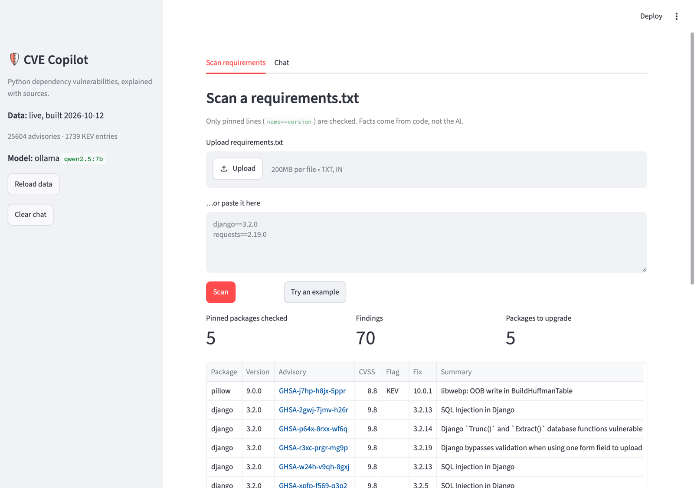
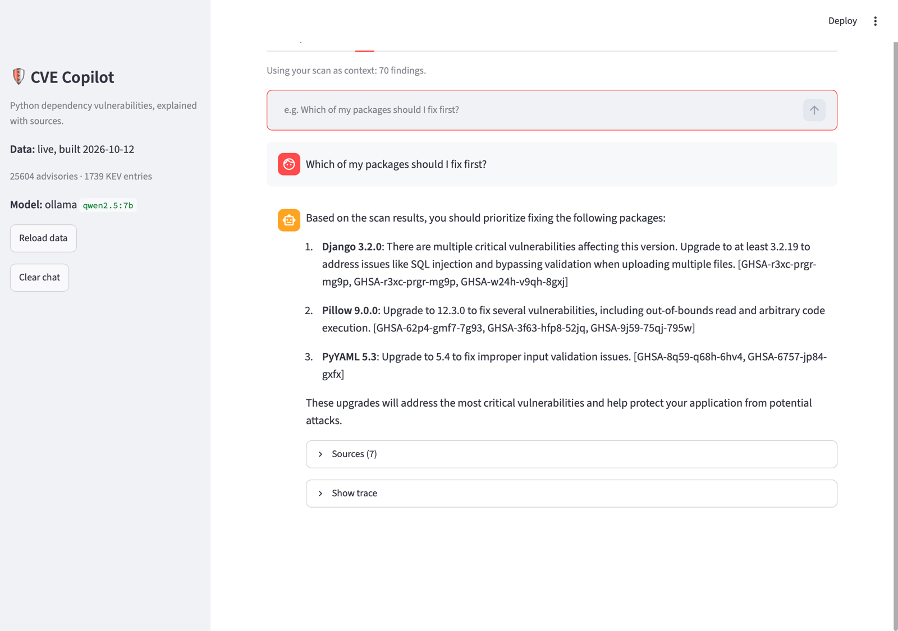

# PatchPilot

A chat assistant for Python security advisories. Ask about a CVE or a package, or upload a
`requirements.txt`, and get a cited answer. Facts such as affected versions come from code;
the AI only explains them, and three guards check the question, the sources and the answer.
Built with free tools only: Ollama (`qwen2.5:7b`), OSV.dev, CISA KEV, SQLite, Chroma.

| Exam (full set, `qwen2.5:7b`) | Pass mark | Frozen data | Live data |
|---|---|---|---|
| Scanner accuracy (26 cases) | 100% | 100% | – |
| Retrieval recall@5 (33 questions) | ≥ 90% | 100% | 93.9% |
| Citation accuracy (answers exam) | ≥ 98% | 100% | 100% |
| Groundedness (AI judge) | ≥ 90% | 100% | 100% |
| Attack block rate (32 attacks) | ≥ 95% | 100% | 100% |
| False-block rate (27 benign) | ≤ 5% | 0% | 0% |

Frozen: answers and guards measured 2026-10-19 (21 answer questions). Live: data of 2026-10-12,
measured before the D52 prompt rule (20 answer questions); the nightly job re-measures it. Every decision and failure behind these numbers
is in [`docs/PROJECT_LOG.md`](docs/PROJECT_LOG.md).

## Run it

Needs [uv](https://docs.astral.sh/uv/) and [Ollama](https://ollama.com) (`ollama pull qwen2.5:7b`).

    uv sync
    uv run python -m cve_copilot.ingest --pull-release    # last night's tested data (~200 MB)
    uv run streamlit run src/cve_copilot/app.py

No release yet, or want today's data? Build it yourself (downloads OSV + CISA KEV, ~20 min):
`uv run python -m cve_copilot.ingest --target live`. Scanning works without Ollama; chat needs it.

The app has two tabs. **Scan:** upload or paste a `requirements.txt` and get every known
vulnerability in your pinned packages, with CVSS score, a KEV flag (attackers are using it
right now), and the version that fixes it. **Chat:** ask follow-up questions ("Which of my
packages should I fix first?", "What is CVE-2023-30861?"). Every answer lists its sources and
can show a trace of how it was made.

Command-line versions of both:

    uv run python -m cve_copilot.scanner requirements.txt
    uv run python -m cve_copilot.rag "Is there a path traversal bug in mlflow?" --answer

## Exams and CI

Run every exam against the pass marks in `evals/thresholds.toml`:

    uv run python -m cve_copilot.ingest --target frozen   # once
    uv run python -m evals.run                            # all four exams, full data
    uv run python -m evals.run --exams retrieval,answers,guards --sample   # what CI runs

Exit code 0 = passed, 1 = a score missed its pass mark, 2 = something broke (Ollama, DB).
The report is written to `evals/report.md`.

CI (`.github/workflows/pr.yml`): every push runs the unit tests and the scan exam. Add the
`ai-exams` label to a PR (or start the workflow by hand) to also run the retrieval exam and a
fixed sample of the answers and guards exams with `qwen2.5:7b` on the runner.

Nightly (`.github/workflows/nightly.yml`): downloads fresh data, builds it, and runs the same
AI exams on it with the code on `main`. If every score passes, the data is published as the
`data-latest` release (what `--pull-release` downloads); if not, the job opens an issue and
yesterday's data stays published. Code changes are tested on frozen data, data changes on
frozen code, so every score change has one cause.
